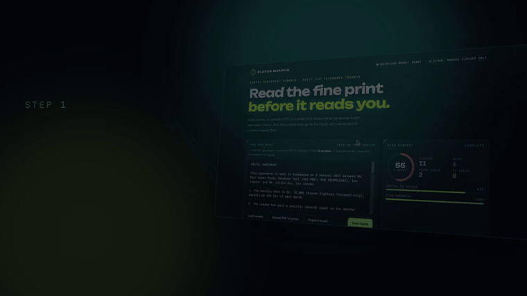
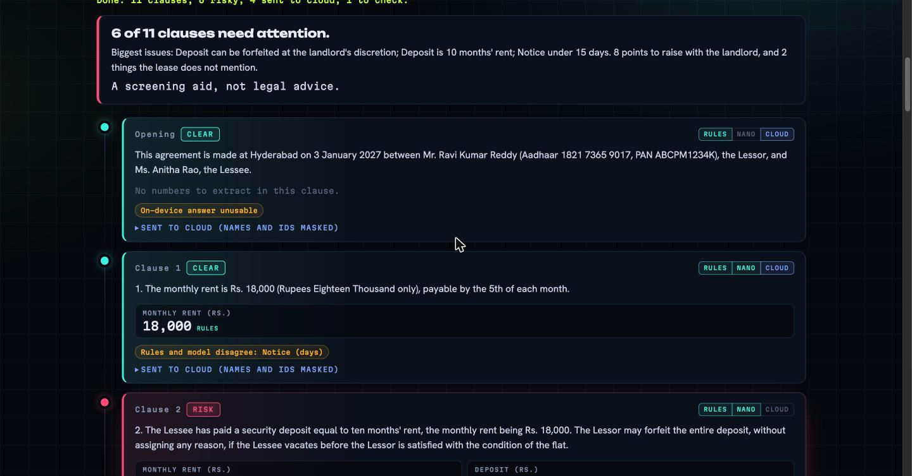
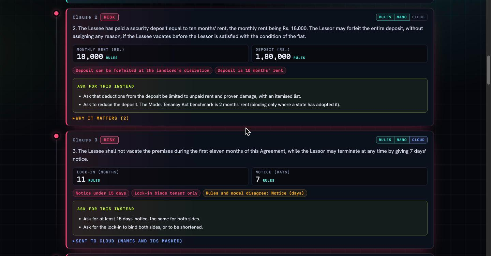
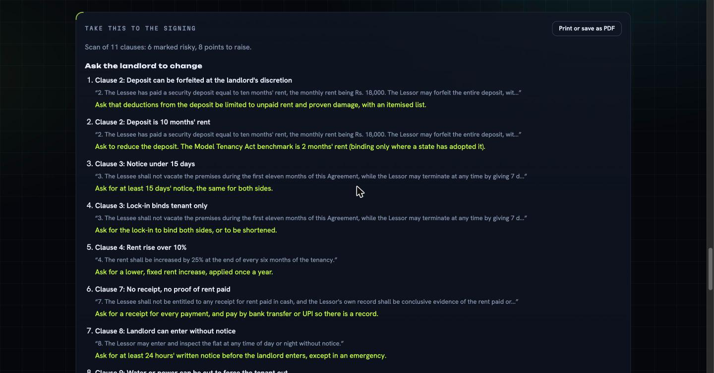

<p align="center">
  
</p>

<p align="center">
  <a href="https://eleven-months-nano.web.app"><b>Open the live app</b></a>
  &nbsp;·&nbsp; desktop Chrome for the full scan
  &nbsp;·&nbsp; <a href="LICENSE">Apache-2.0</a>
  &nbsp;·&nbsp; built for the Firebase hybrid AI hackathon, 2026
</p>

# Eleven Months

Most rental agreements in Hyderabad run for eleven months and are signed in a few minutes. Eleven Months reads the agreement first. Paste the text, or upload a PDF or a photo of the page, and it marks the clauses that can cost you money or your home, says what to ask for instead, and gives you a sheet to take to the signing.

It is a screening aid, not legal advice.

<p align="center">
  
</p>

## What you get

| | |
|---|---|
|  | **A verdict in plain words.** Each clause is marked clear or risky, with the figures that matter (deposit, lock-in, notice, rent increase) and where each figure came from. |
|  | **What to ask for instead.** Every risky clause comes with a concrete request, tied to a public benchmark and a note you can open. |
|  | **A sheet for the signing.** The points to raise, what the agreement leaves out, and a checklist for the flat visit. Print it or save it as a PDF. |

It also:

- reads photos and scanned PDFs on your device, then shows the text so you can correct it before the scan;
- checks the whole agreement: are the parties, address, start date, term and rent stated, do any figures contradict each other, and roughly what the stamp duty should be;
- has step-by-step guides for seven situations (before signing, water or power cut, told to leave, deposit not returned, moving out, rent increase, asked for a bribe);
- has 25 short notes on rental law, each showing its source, how far it can be trusted, and what could not be verified.

## What it works on, and what it does not

| Works on | Does not work on yet |
|---|---|
| Rental and lease agreements in English, from any Indian state | Agreements in Telugu, Hindi or Urdu, including Hindi written in English letters. These are declined with a message, not scanned badly |
| Pasted text, text PDFs, photos, scanned PDFs (up to 12 pages) | Handwriting, tables and two-column layouts |
| Clause checks: deposit size and forfeiture, notice, lock-in, rent increases, entry, water and power cuts, receipts, lock-out, blank cheques, painting and wear deductions, late fees, taxes and society charges | Leave and licence, paying-guest and commercial documents get a warning: some checks will not fit |
| Local law notes, fees and contacts for **Telangana** | Local law for other states |

## How the hybrid inference works

Every model call goes through the Firebase AI Logic Web SDK (`firebase/ai`). See [`app/src/ai.ts`](app/src/ai.ts).

```
 clause ──► 1. Rules          deterministic: amounts, months, days, percentages, 23 topic rules
            │
            ▼
            2. Gemini Nano    on the device, in Chrome: judges the clause and finds names
            │
            ▼  only if Nano's answer is unusable, the rules are unsure,
            │  rules and Nano disagree, or Nano says "ok" while a rule flags a risk
            ▼
            3. Cloud Gemini   the clause is masked first: names, Aadhaar, PAN, phones, emails
```

- **Privacy by routing.** In the sample agreement, 2 of 11 clauses go to the cloud. If the on-device names check fails, the clause is not sent at all.
- **Rules win on numbers.** A model never overrides a figure the rules extracted.
- **App Check** protects the cloud calls (reCAPTCHA Enterprise in production).
- **No on-device model?** Phones, Safari and Firefox get a rules-only scan. It says so, and it says how many clauses matched no rule.

## Measured, not claimed

All test data is synthetic and written for this project. Numbers on real agreements will be lower.

| What | Result |
|---|---|
| Gemini Nano alone, 40 clauses | 34 labels correct, 15 of 20 risky clauses found |
| Rules + Nano, cloud on trigger | 40 of 40 labels correct with 13 of 40 clauses sent to cloud |
| Fixed rules alone on an unseen set of harmful clauses, first run | 12 of 20 (second set), then **4 of 20** (third set, fresh paraphrases); 0 fair clauses wrongly flagged on the third set |
| Nano's per-call limit | fails between about 6,200 and 8,000 words, so long clauses are split |

The third row is the honest limit of this project: the rules are precise and good with numbers, but they do not recognise new wordings of the same problem. That is the model's job, and it is why the rules-only mode is the weakest. Details: [`RISK-KILL-REPORT.md`](RISK-KILL-REPORT.md), [`GAP-REPORT.md`](GAP-REPORT.md), [`SCHEDULE.md`](SCHEDULE.md), [`AUDIT.md`](AUDIT.md).

## Run it

Requirements: Node 23.6 or newer. For the full scan, desktop Chrome with the built-in model (the first use downloads about 4 GB).

```bash
cd app
npm install
cp .env.example .env.local   # your Firebase web config; needed only for cloud calls
npm run dev
```

Cloud calls need a Firebase project (the free Spark plan is enough), Firebase AI Logic with the Gemini Developer API, and App Check. In development, register an App Check debug token in the Firebase console. Without a Firebase config, the rules and the on-device model still work.

Tests (no extra dependencies):

```bash
node --test --no-warnings rules/*.test.ts app/src/*.test.ts
```

Measure the rules on the unseen clause sets:

```bash
node --no-warnings rules/probe-realworld3.ts
```

## Layout

- `app/` the web app (Vite, TypeScript): UI, masking, clause splitter, PDF and photo reading.
- `rules/` extractor, topic rules, whole-agreement checks, document check, reference notes, guides, routing pipeline, scoring tools. See [`rules/README.md`](rules/README.md) and [`rules/EXPANDING.md`](rules/EXPANDING.md).
- `harness/` the measurement page and raw results behind the risk report.
- `docs/` images for this page.

## Built during the hackathon

Everything in this repository was written between 17 and 18 November 2026, inside the submission period. There is no pre-existing code. Dependencies are the Firebase SDK, pdf.js, Tesseract.js (text recognition, runs in the browser) and three open fonts.

The code was written with an AI coding assistant, which the rules allow. The measurements were run on a real machine and are reported as measured, including the ones that came out badly.

## Limits you should know

- A screening aid, not legal advice. "Nothing found" does not mean "safe to sign".
- Not tested on a real camera photo, on handwriting, or on a phone.
- Five legal questions are still unverified and are listed inside the app under "What this tool could not verify", among them the current Telangana stamp duty rate for leases.
- The local law notes cover Telangana only, and the control act there excludes many newer and higher-rent buildings, so the guides tell you to check coverage first.

## Licence

[Apache-2.0](LICENSE).
