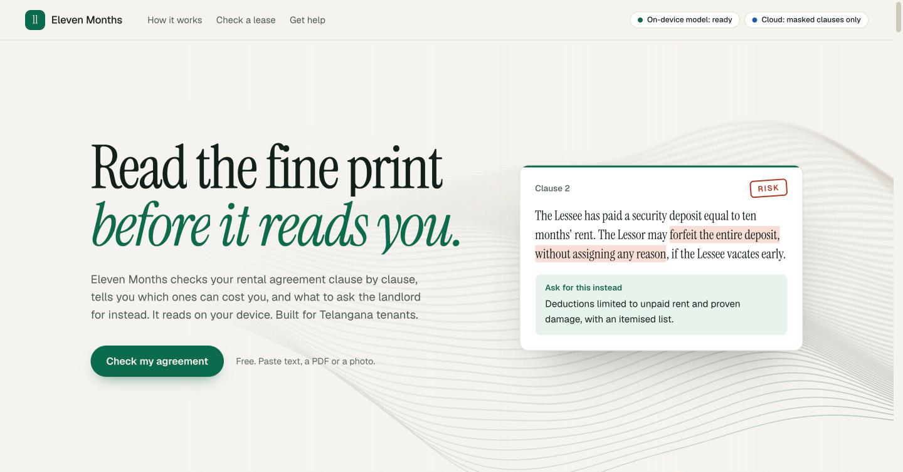
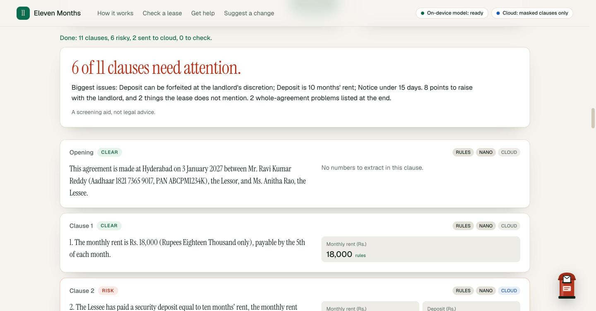
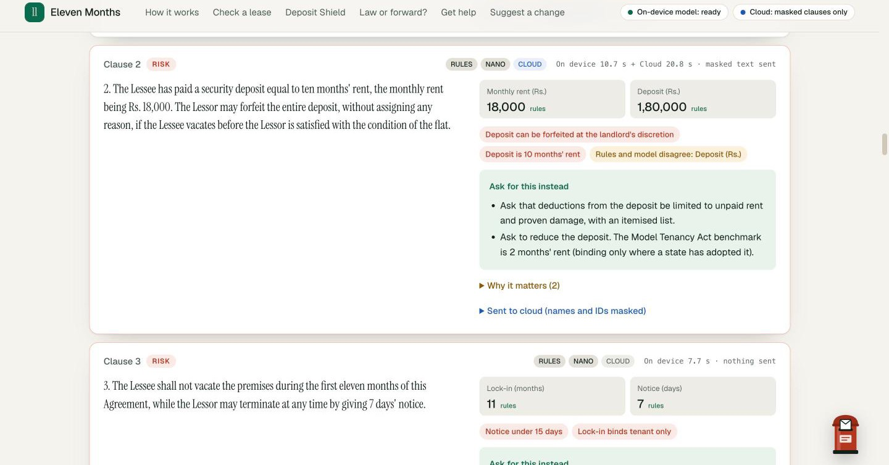
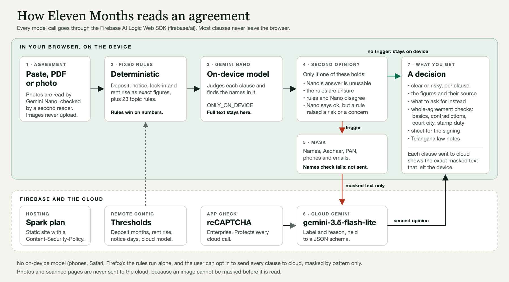

<p align="center">
  
</p>

<p align="center">
  <a href="https://eleven-months-nano.web.app"><b>Open the live app</b></a>
  &nbsp;·&nbsp; desktop Chrome for the full scan
  &nbsp;·&nbsp; <a href="LICENSE">Apache-2.0</a>
  &nbsp;·&nbsp; built for the Firebase hybrid AI hackathon, 2026
</p>

# Eleven Months

Most rental agreements in Hyderabad run for eleven months and are signed in a few minutes. Eleven Months reads the agreement first. Paste the text, or upload a PDF or a photo of the page, and it marks the clauses that can cost you money or your home, says what to ask for instead, and gives you a sheet to take to the signing.

It is a screening aid, not legal advice.

**Three surfaces:** the [web app](https://eleven-months-nano.web.app), a [Chrome extension](extension/README.md) that checks a clause wherever you select it, and an [Android app (Trusted Web Activity)](android/README.md): the same web app, running in Chrome on Android.

> **For judges**
> 1. Open **https://eleven-months-nano.web.app** in desktop Chrome 139 or newer. No login.
> 2. Press **Load sample**, then **Scan lease**. (Press **Prepare model** first if the page asks; the first answer after a Chrome restart takes 13 to 20 s.)
> 3. On any clause marked "Sent to cloud (names and IDs masked)", open it to see the exact text that left the device.
>
> Measured results: [Measured, not claimed](#measured-not-claimed) below, with the details in [`SCHEDULE.md`](SCHEDULE.md), [`RISK-KILL-REPORT.md`](RISK-KILL-REPORT.md) and [`GAP-REPORT.md`](GAP-REPORT.md).

<p align="center">
  
</p>

<p align="center">
  
</p>

## What you get

| | |
|---|---|
|  | **A verdict in plain words.** Each clause is marked clear or risky, with the figures that matter (deposit, lock-in, notice, rent increase) and where each figure came from. Each clause also says where it ran and how long it took, for example "On device 5.6 s + Cloud 18.2 s · masked text sent". |
|  | **What to ask for instead.** Every risky clause comes with a concrete request, tied to a public benchmark and a note you can open. |
|  | **A sheet for the signing.** The points to raise, what the agreement leaves out, and a checklist for the flat visit. Print it or save it as a PDF. |

It also:

- reads photos and scanned PDFs on your device with the on-device model, checks that reading word by word against a second, plain text recogniser, and shows the text so you can correct it before the scan;
- checks the whole agreement: are the parties, address, start date, term and rent stated, do any figures contradict each other, and roughly what the stamp duty should be;
- **Deposit Shield**, for moving out: checks each line of the landlord's deduction list against your own agreement ("in your agreement", "ask for the bill", "not in your agreement"), totals it against the deposit, and writes a firm WhatsApp message and a formal notice through the same masked cloud path, plus a move-out checklist and an escalation ladder (Telangana specifics, national routes for other states);
- **Law, or viral forward?**: eight viral "new rent rules" claims checked for Telangana, Karnataka and Maharashtra, each marked in force, Model Tenancy Act proposal not adopted there, not true, partly true, or could not verify, with sources and a checked date;
- has step-by-step guides for seven situations (before signing, water or power cut, told to leave, deposit not returned, moving out, rent increase, asked for a bribe);
- has 27 short notes on rental law, each showing its source, how far it can be trusted, and what could not be verified.

## What it works on, and what it does not

| Works on | Does not work on yet |
|---|---|
| Rental and lease agreements in English, from any Indian state | Agreements in Telugu, Hindi or Urdu, including Hindi written in English letters. These are declined with a message, not scanned badly |
| Pasted text, text PDFs, photos, scanned PDFs (up to 12 pages) | Handwriting, tables and two-column layouts |
| Clause checks: deposit size and forfeiture, notice, lock-in, rent increases, entry, water and power cuts, receipts, lock-out, blank cheques, painting and wear deductions, late fees, taxes and society charges | Leave and licence, paying-guest and commercial documents get a warning: some checks will not fit |
| Local law notes, fees and contacts for **Telangana**; the viral-claims check also covers Karnataka and Maharashtra | Local law notes for other states |

## How the hybrid inference works

<p align="center">
  
</p>

Every model call goes through the Firebase AI Logic Web SDK (`firebase/ai`). See [`app/src/ai.ts`](app/src/ai.ts).

```
 clause ──► 1. Rules          deterministic: amounts, months, days, percentages, 27 topic rules
            │
            ▼
            2. Gemini Nano    on the device, in Chrome: judges the clause and finds names
            │
            ▼  only if Nano's answer is unusable, the rules are unsure,
            │  rules and Nano disagree, or Nano says "ok" while a rule flags a risk
            ▼
            3. Cloud Gemini   the clause is masked first: names, Aadhaar, PAN, phones, emails
```

- **Privacy by routing.** In the sample agreement, 2 of 11 clauses went to the cloud in the recorded run, and 3 and 4 in two re-runs on 19 Nov (Gemini Nano does not answer the same way every time, so the count varies by run). If the on-device names check fails, the clause is not sent at all.
- **Every clause shows where it ran and how long it took**, for example "On device 3.9 s · nothing sent" or "On device 5.5 s + Cloud 1.8 s · masked text sent". The source comes from the SDK's `inferenceSource`, and while Gemini Nano reads, the status line counts the seconds.
- **A stalled model cannot freeze the scan.** Each on-device call has a 60-second limit (we once saw Gemini Nano stall for over 30 minutes on one clause). A call that runs out counts as an unusable on-device answer, so the clause gets the masked cloud second opinion like any other.
- **Rules win on numbers.** A model never overrides a figure the rules extracted.
- **App Check** protects the cloud calls (reCAPTCHA Enterprise in production).
- **Remote Config** holds the thresholds (deposit months, rent rise, notice days), the cloud model name and the switch for the cloud second opinion, so they can change without a deploy. Every value is range-checked and falls back to a built-in default. See [`app/src/config.ts`](app/src/config.ts).
- **Photos stay on the device.** A page image is read by the on-device model through Firebase AI Logic and never sent to the cloud, because it cannot be masked before it is read. A model can skip or reword a line without showing it, so its reading is used only when it shares at least 90% of its words with a plain text recogniser's reading of the same page.
- **Which surfaces call the cloud: the web app only.** The cloud second opinion is protected by App Check, whose reCAPTCHA flow does not run in extension pages. So the Chrome extension's own pages run the rules and Gemini Nano through Firebase AI Logic in `ONLY_ON_DEVICE` mode, with a Content-Security-Policy (`connect-src 'self'`) that blocks any network call. Its **Full app** tab is the web app itself, framed in the side panel: the live site, on its own origin, so its cloud calls run under App Check as on the site. The text moves across in the URL fragment, which is never sent to a server. The Android app is a Trusted Web Activity, so it is the web app itself; Chrome on Android has no on-device model yet, so there it runs the rules plus the opt-in cloud check.
- **No on-device model?** Phones, Safari and Firefox get a rules-only scan. It says so, and it says how many clauses matched no rule. The user can tick a box to also send every clause to the cloud model. In that mode masking is by pattern only (ID numbers, phones, emails, names after a title), because there is no on-device model to find names, and the page says that before the user ticks.

## Measured, not claimed

All test data is synthetic and written for this project. Numbers on real agreements will be lower.

| What | Result |
|---|---|
| Gemini Nano alone, 40 clauses | 34 labels correct, 15 of 20 risky clauses found |
| Rules + Nano, cloud on trigger | 40 of 40 labels correct with 15 of 40 clauses sent to cloud (offline replay of saved outputs, `node rules/replay.ts`; it was 13 before medium rule findings also asked for a second opinion) |
| Fixed rules alone on an unseen set of harmful clauses, first run | 12 of 20 (second set), then **4 of 20** (third set, fresh paraphrases); 0 fair clauses wrongly flagged on the third set |
| Whole pipeline on 96 unseen clauses (70 harmful, 26 fair), desktop Chrome, live site | **67 of 70** harmful caught, 1 of 26 fair wrongly flagged, 45 of 97 scanned pieces sent to cloud (the 96 clauses plus the test agreement's opening line, which the splitter counts as a clause) |
| Same clauses with no on-device model (rules + cloud on every clause) | 68 of 70 caught, 0 of 26 wrongly flagged |
| Lifestyle-clause rules (curfew, visitors, occupants, food), fresh set written after the rules, first run | 7 of 8 harmful flagged, 0 of 4 fair; on the 96 unseen clauses only 2 harmful clauses gained a finding and no fair clause changed ([`rules/results-lifestyle.md`](rules/results-lifestyle.md)) |
| Deposit Shield auditor, three synthetic deduction lists (fair, inflated, charges absent from the agreement) | 17 of 17 lines as the hand-written gold; a fourth list written after that, first run, 7 of 8 (one wrong "in your agreement", since fixed). Same author wrote rules and lists ([`rules/results-deposit.md`](rules/results-deposit.md)) |
| Nano's per-call limit | fails between about 6,200 and 8,000 words, so long clauses are split |

The third row is the honest limit of the fixed rules: precise and good with numbers, but they do not recognise new wordings of the same problem. The fourth row shows the model covering that gap. All 96 clauses were written by the project's author in clean English, so real agreements will score lower. Details: [`RISK-KILL-REPORT.md`](RISK-KILL-REPORT.md), [`GAP-REPORT.md`](GAP-REPORT.md), [`SCHEDULE.md`](SCHEDULE.md), [`AUDIT.md`](AUDIT.md).

## Install and run, from zero

You need three things on your computer:

- **Git**, to copy the code. Check with `git --version`.
- **Node.js 23.6 or newer** (the tests run TypeScript files directly). Check with `node --version`. Get it from https://nodejs.org.
- **Google Chrome on a desktop or laptop**, version 139 or newer, for the on-device model. Any other browser still runs the fixed rules.

### 1. Get the code

```bash
git clone https://github.com/pruthvig1998/eleven-months.git
cd eleven-months
```

### 2. Install and start the app

```bash
cd app
npm install
npm run dev
```

The last command prints a local address, normally `http://localhost:5173`. Open it in Chrome. Press **Load sample**, then **Scan lease**.

At this point the fixed rules and the on-device model work. Cloud checks are off, and the page says so ("Cloud: off"). That is enough to try the app.

### 3. Turn on the on-device model (once per computer)

Chrome downloads the model, about 4 GB, the first time a page asks for it.

1. In the app, press **Prepare model** and wait for the pill at the top to say "On-device model: ready". The page shows the download progress.
2. If the pill says "unsupported" or "unavailable", open `chrome://on-device-internals` in Chrome to see the model's status. The model needs a recent desktop Chrome, enough free disk space (Chrome asks for about 22 GB free) and a supported graphics card or enough memory. Chrome's own requirements are listed at https://developer.chrome.com/docs/ai/get-started.
3. After you restart Chrome, the first answer can take 13 to 20 seconds while the model loads.

### 4. Turn on cloud checks (optional)

Cloud checks need your own Firebase project. The free Spark plan is enough.

1. Go to https://console.firebase.google.com and create a project.
2. In the project, add a **Web app** (the `</>` icon). Firebase shows a config block with `apiKey`, `authDomain`, `projectId` and `appId`.
3. In the left menu open **AI Logic**, press **Get started**, and choose the **Gemini Developer API**.
4. Copy the example settings file and fill it in with the values from step 2:

   ```bash
   cp .env.example .env.local
   ```

   ```
   VITE_FIREBASE_API_KEY=...
   VITE_FIREBASE_AUTH_DOMAIN=...
   VITE_FIREBASE_PROJECT_ID=...
   VITE_FIREBASE_APP_ID=...
   VITE_RECAPTCHA_SITE_KEY=
   ```

   Leave `VITE_RECAPTCHA_SITE_KEY` empty for local work. `.env.local` is ignored by git; never commit it.
5. Stop the dev server (Ctrl+C) and run `npm run dev` again. Open the page, open Chrome's developer console (View, Developer, JavaScript Console) and copy the **App Check debug token** it prints.
6. In the Firebase console open **App Check**, then **Apps**, open the menu on your web app, choose **Manage debug tokens**, and add the token. Never commit this token or paste it anywhere public.
7. Reload the page. The pill now says "Cloud: masked clauses only".

### 5. Run the tests

From the top folder of the repository (not `app/`):

```bash
cd ..
node --test --no-warnings rules/*.test.ts app/src/*.test.ts
```

You should see `fail 0`. To measure the fixed rules on the unseen clause sets:

```bash
node --no-warnings rules/probe-realworld3.ts
```

### 6. Put it online (optional)

The app is a static site. To host it on Firebase Hosting in your own project:

1. In the Firebase console, open **App Check**, register your web app with **reCAPTCHA Enterprise**, and put the site key in `.env.local` as `VITE_RECAPTCHA_SITE_KEY`. Production does not use the debug token.
2. Edit `app/.firebaserc` and replace `eleven-months-nano` with your own project ID.
3. Build and deploy:

   ```bash
   cd app
   npm run build
   npx firebase-tools login
   npx firebase-tools deploy --only hosting
   ```

### If something goes wrong

| What you see | What to do |
|---|---|
| `node: bad option` or a syntax error when running the tests | Your Node.js is older than 23.6. Update it. |
| "On-device model: unsupported" | The browser has no built-in model. Use desktop Chrome 139 or newer. The fixed rules still run. |
| The model download stays at 90% | It is verifying the download. Leave the page open. |
| "Cloud check failed" on every clause | The App Check debug token is not registered (step 4.6), or AI Logic is not enabled (step 4.3). |
| "Cloud: off" | `.env.local` is missing or empty. Cloud checks are optional. |
| The first clause takes a long time | The model is loading into memory. Later clauses are faster. Close other heavy programs. |

## Layout

- `app/` the web app (Vite, TypeScript): UI, masking, clause splitter, PDF and photo reading.
- `rules/` extractor, topic rules, whole-agreement checks, document check, reference notes, guides, routing pipeline, scoring tools. See [`rules/README.md`](rules/README.md) and [`rules/EXPANDING.md`](rules/EXPANDING.md).
- `extension/` the Chrome extension (side panel and context menu, on-device only). See [`extension/README.md`](extension/README.md).
- `android/` the Trusted Web Activity setup (Bubblewrap). The signing key stays outside the repository. See [`android/README.md`](android/README.md).
- `harness/` the measurement page and raw results behind the risk report.
- `docs/` images for this page.

## Suggestions and corrections

The site has a **Suggest a change** panel. Every suggestion becomes a GitHub issue labelled `inbox` and its type, for review. Today it opens a prefilled GitHub issue form (needs a free GitHub account). Three no-account routes (Cloudflare Worker, Google Form, Firestore) are built and switch on once configured: see [SUGGESTIONS.md](SUGGESTIONS.md).

## Built during the hackathon

Everything in this repository was written between 17 and 18 November 2026, inside the submission period. There is no pre-existing code. Dependencies are the Firebase SDK, pdf.js, Tesseract.js (text recognition, runs in the browser) and three open fonts.

The code was written with an AI coding assistant, which the rules allow. The measurements were run on a real machine and are reported as measured, including the ones that came out badly.

## Limits you should know

- A screening aid, not legal advice. "Nothing found" does not mean "safe to sign".
- Not tested on a real camera photo or on handwriting. On a phone, only the install and full-screen launch of the Android app were checked (19 Nov), not a full scan there.
- Five legal questions are still unverified and are listed inside the app under "What this tool could not verify", among them the current Telangana stamp duty rate for leases.
- Chrome on Android has no on-device model yet, so the Android app runs the fixed rules with the opt-in cloud check, not the full hybrid scan.
- The local law notes cover Telangana only, and the control act there excludes many newer and higher-rent buildings, so the guides tell you to check coverage first.

## Credits

- Music in the demo video: "Happy Beats & Business Moves Vol. 11" by Sascha Ende, [ende.app](https://ende.app/en), licensed CC BY 4.0. The video itself is not in this repository.
- Text recognition: [Tesseract.js](https://github.com/naptha/tesseract.js) (Apache-2.0). PDF reading: [pdf.js](https://github.com/mozilla/pdf.js) (Apache-2.0).
- Fonts: Instrument Serif and Geist (SIL Open Font License), through Fontsource.
- Motion: [GSAP](https://gsap.com) and [Lenis](https://lenis.dev). The hero background is the "Threads" component from [React Bits](https://reactbits.dev), copied into `app/src/vendor/react-bits/` under its own MIT + Commons Clause licence (not Apache-2.0), used as part of this application only.

## Licence

[Apache-2.0](LICENSE).
